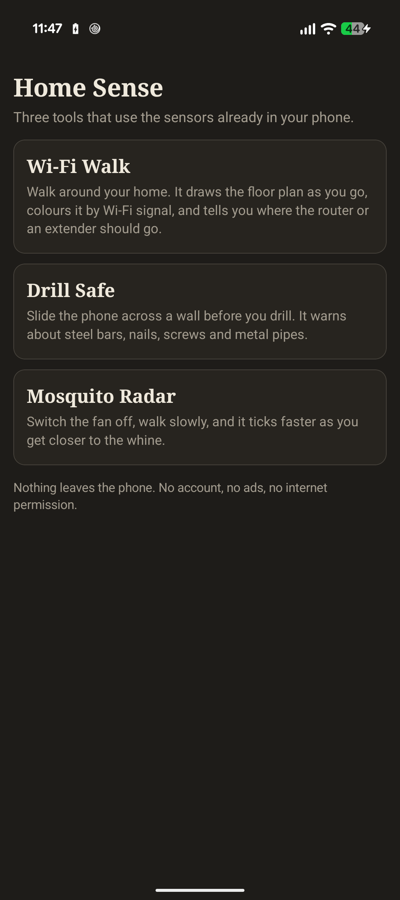
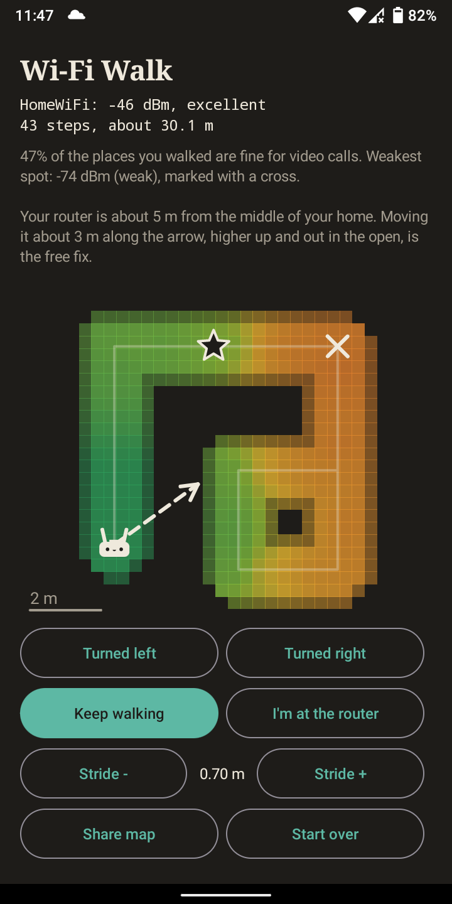
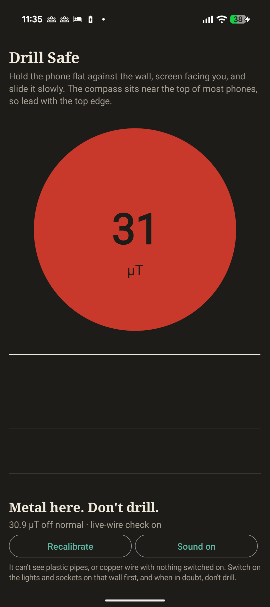
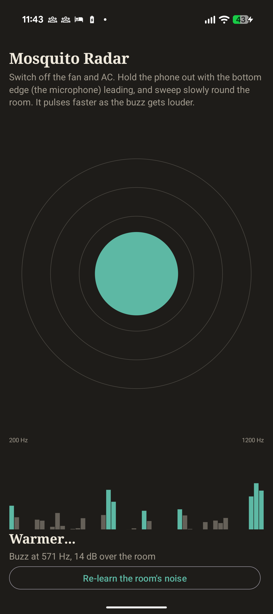

# Home Sense

Three tools for your home that use the sensors already inside your phone. No account, no ads,
and no internet permission at all, so nothing can leave the phone.

<p align="center">
  <a href="https://apps.obtainium.imranr.dev/redirect?r=obtainium://add/https://github.com/mark-alexander-hub/home-sense"></a>
  <a href="https://github.com/mark-alexander-hub/home-sense/releases/latest"></a>
</p>

<p align="center">
  
  
  
  
</p>
<p align="center"><sub>The Wi-Fi Walk picture is the built-in demo walk; the network name in it is made up.</sub></p>

## Wi-Fi Walk

Hold the phone in front of you and walk slowly through your home. Home Sense counts your steps,
works out which way you're facing, and measures the Wi-Fi as you go, so **the floor plan draws
itself**, coloured green to red by signal. No drawing, no uploading a plan, no tapping where you are.

When you tap **Done** it tells you, in plain words:

- how much of your home is fine for video calls, and where the weakest spot is (the cross)
- if you marked the router: how far it is from the middle of your home and which way to move it (the arrow)
- where an extender or mesh unit should go: the spot nearest the dead zone that still has a good signal (the star)

**Share map** sends the picture and the advice to whoever is going to move the router.

Phones that can't sense turning (some budget phones have no gyroscope or compass) show
**Turned left / Turned right** buttons: tap one at each corner. Rooms are drawn square, so corners
within 20 degrees of a right angle are straightened out. If distances look short or long, adjust the
stride (0.70 m is an average adult step).

## Drill Safe

Hold the phone flat against the wall and slide it slowly. Steel bars, nails, screws and metal pipes
bend the earth's magnetic field, and the compass chip in the phone feels it: green is clear, amber is
"something metal nearby", red is "metal here, don't drill". It clicks faster, like a Geiger counter,
the closer you get.

**What it can't do, honestly:** it finds metal, not electricity. Copper wire and plastic pipes are
invisible to it. I tried detecting live wires from their 50 Hz field, and on a Pixel 10a the compass
didn't see it, even right against a running appliance's cable. Phone compasses are filtered too
heavily for that. So the app doesn't claim it. Wiring usually runs straight up or down from switches
and sockets, so don't drill in line with them, and use a tester pen for live wires.

Needs a compass (magnetic sensor). Most phones have one; the app tells you if yours doesn't.

## Mosquito Radar

Switch off the fan and AC, hold the phone out with the microphone end leading, and sweep slowly
around the room. A mosquito's wings beat 300 to 1000 times a second and make a thin, steady tone
with a clear overtone. Home Sense listens for exactly that, compared with the room's own background
noise, and pulses faster as the buzz gets louder.

It ignores voices and music (their root note is below the mosquito range, so their overtones come
with a strong partner at half the pitch), and a buzz has to hold steady for half a second before it
counts. It works best within about a metre in a quiet room, which is also when a mosquito is most
annoying.

Audio is analysed in memory a twentieth of a second at a time and thrown away. Nothing is recorded.

## Permissions

| Permission | Why |
|---|---|
| Location | Android only lets apps see the Wi-Fi network's name with it. Home Sense never reads GPS. Signal strength works without it. |
| Microphone | Mosquito Radar. Live analysis only, nothing saved. |
| Vibrate | Ticks and warnings. |

No internet permission, so the app cannot send anything anywhere.

## Tested on

- Lenovo K9 (Android 10): accelerometer only, no compass or gyroscope, so manual corners in
  Wi-Fi Walk, and Drill Safe says it can't run
- Google Pixel 10a (Android 17): everything

## Build it yourself

```
gradlew assembleDebug
```

The APK lands in `app/build/outputs/apk/debug/`. JDK 17+ and the Android SDK are all you need.

## Licence

MIT. Built by Mark Isidore Nicholas Alexander.
